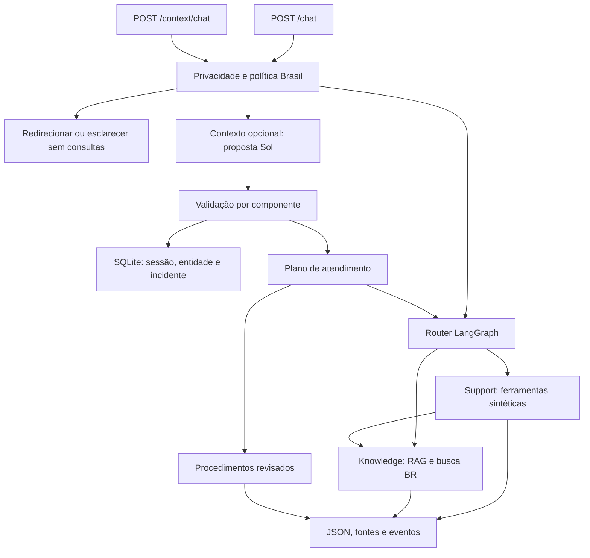

# Arquitetura vigente

A entrada operacional é `app.context_api:app`; `app.main` fornece a fábrica compartilhada da API stateless. O sistema preserva três papéis, sem exigir um quarto agente.

## Responsabilidades e comunicação

- `app/router.py` e `app/orchestration.py`: classificação, sequência e passagem de contratos Pydantic entre nós LangGraph. Cada especialista devolve resposta, status, fontes e eventos. O grafo tem percurso limitado e falhas controladas.
- `app/knowledge.py` e `app/rag/`: recuperação, pertinência de produto/atributo/mercado, condições e fonte. A resposta padrão é extrativa ou editorialmente revisada; existência de URL não prova correção.
- `app/support.py`: `consultar_recebiveis` e `consultar_terminal`. Dados fictícios vinculados pelo servidor a identidades de demonstração; leitura, não operação financeira. Intervalos distinguem venda/crédito, validam limites e usam fuso UTC-03.
- `app/service_policy.py` e `app/brazil_scope.py`: separar fora do assunto/mercado de partes brasileiras, esclarecer geografia ambígua e evitar consultas desnecessárias. País por aparelho prevalece sobre inferência a partir de outra cláusula; cartão estrangeiro não muda o mercado da loja.

## Contexto e limites de confiança

`context_model.py`/`context_solo.py` propõem entidades, observações, pedidos e revisões seletivas. Quotes são literais; origem, certeza e incidente acompanham os fatos. A revisão de um componente ambíguo não apaga componentes independentes. Uma proposta do modelo continua falível.

`context_state.py` aplica invariantes e transações por dependência; correções e retratações mantêm origem e versões. `context_store.py` usa SQLite, versão CAS e MAC. Restrições de escopo são metadados de roteamento, não autorização nem prova da situação real do cliente. `user_id` e sessão opaca demonstram isolamento, não autenticação bancária. MAC não protege contra administrador com acesso à chave.

`context_service.py` seleciona os fatos pertinentes para procedimentos revisados ou núcleo de agentes. Falha do modelo é explicitamente informada; pergunta autocontida pode usar resposta extrativa. A continuidade no modo sem intérprete é limitada e possui falha conhecida de retomada, descrita em [Limitações](LIMITACOES.md).

## RAG e busca

Ingestão fora do atendimento: TLS, allowlist, limites de tamanho/tempo e revisão editorial. Snapshots guardam URL, título, mercado, data e hashes. O índice é lexical. Recuperação de comparação e perguntas compostas considera evidências dos subpedidos, mantendo condições no título/corpo. Nenhuma exigência de embeddings ou banco vetorial foi inventada.

O corpus operacional é brasileiro; snapshots globais `getnet.net/en` preservam o requisito de ingestão/proveniência, sem disponibilizar suporte de outros países. `context_evidence.json` limita a publicação editorial do contexto. `dcc_source.json` tem hash próprio, preservado pelo atributo Git `-text`.

Busca externa é opt-in, pertinente ao atendimento brasileiro. RSS filtrado e catálogo de Link/antecipação têm diagnósticos distintos. Fonte indisponível é diferente de fonte insuficiente; não se fabrica resposta. Conteúdo externo, metadados e anexos não viram comandos, memória acionável ou ferramentas.

## Segurança e observabilidade

Credenciais explícitas das classes testadas são redigidas antes de memória, modelo e ledger, preservando informações não sensíveis. Instrução legítima de digitar senha no aparelho é distinta de solicitar senha no chat. Detectores são limitados e não garantem classificação universal.

Eventos registram rota, agente/ferramenta, status e duração, sem copiar exceções/credenciais em respostas. O modo real registra tokens, custo/reserva e payloads sintéticos num ledger local; não publicar esse ledger. Há controles de erro HTTP, integridade de fontes, isolamento e concorrência, sem dashboard ou promessa de produção.

## Componentes de modelo

`llm.py` mantém a configuração sem retries para a seleção opcional de evidências RAG por modelo. `context_model.py` e `context_review.py` definem os contratos e prompts de interpretação e revisão contextual. Os dois caminhos e seus resultados estão descritos em [Validação com modelo real](VALIDACAO_MODELO.md).

## Composição de avisos
Avisos criados pelo servidor são blocos internos `Notice`. Somente sua proveniência explícita permite compor uma limitação equivalente uma vez; limites diferentes continuam presentes. Fontes, citações e texto livre são opacos e não podem se passar por esse metadado. Os campos de apresentação são excluídos do JSON público e não substituem texto alterado. A identificação de IA/demonstração e as proteções continuam ativas.
A regra não promete deduplicação universal de texto livre ou remoção de avisos entre turnos. [Validação e limites das evidências](VALIDACAO_ENTREGA.md).
