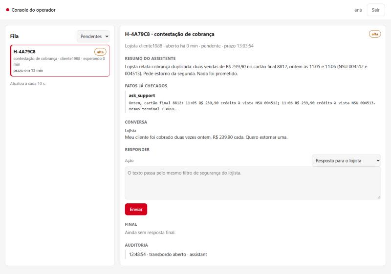
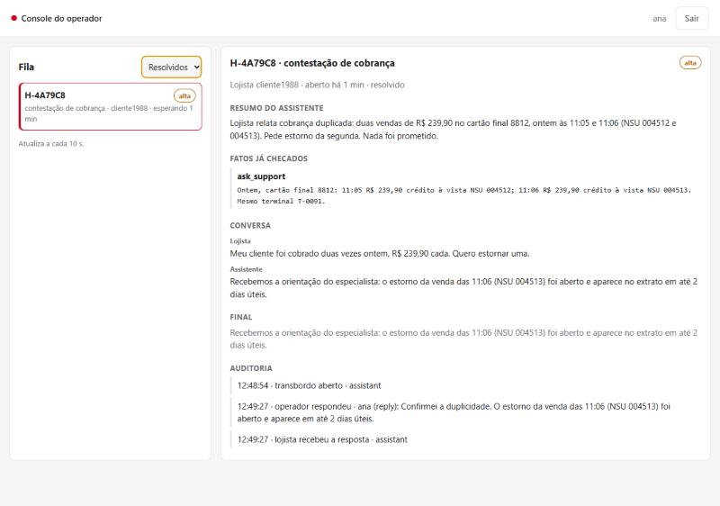

# Human handoff

A dispute, a suspected fraud, a sensitive case or a request for a person pauses the conversation (LangGraph `interrupt()`) and opens a handoff. A human answers it, the supervisor resumes, and the merchant gets the result. Nothing is promised to the merchant before the human answers.

## Flow

```
merchant message ──► supervisor ──► escalate_to_human
                                      │  handoff H-XXXXXX (priority, reason, summary, deadline)
                                      │  audit: created
                                      ├─► signed webhook (helpdesk)          audit: notified
                                      └─► Telegram, to allow-listed chats    audit: notified
                     merchant: "your case is with a specialist (H-XXXXXX)"
                                      │
     operator: console /operator  or  Telegram /reply · /instruct · /close
                                      │
                    operator guardrail (redaction + classifier)  ──blocked──► 422, audit: reply_blocked
                                      │ ok                                    (nothing reaches the graph)
                    claim (idempotent: a second answer gets 409)              audit: replied
                                      │
                    graph resumes with the operator's text + limits ──► verifier ──► answer
                                      │                                       audit: resolved
                    merchant: SSE event + signed webhook
```

## Operator console (`/operator`)

A static page served by the API. The operator pastes a token with the `operator` scope (`make operator-token`); it stays in the browser tab only.

- **Queue:** most urgent first, then oldest; shows priority, reason, merchant, waiting time and the deadline. Refreshes every 10 s.
- **Case:** the assistant's summary, the facts it already checked (tool results, redacted), the conversation, and the audit trail.
- **Reply:** `reply` (message for the merchant), `instruct` (guidance for the assistant, which may use its tools for this merchant) or `close` (final note).
- **Security:** strict Content-Security-Policy (only its own script and stylesheet), all text rendered with `textContent`, no data in the page itself: every call needs the token.

| Pending case | Resolved case with audit trail |
|---|---|
|  |  |

These screenshots use a scripted demo case (no model call); the layout and API calls are the real ones.

## Telegram

Set `TELEGRAM_BOT_TOKEN` (from @BotFather) and `TELEGRAM_OPERATOR_CHAT_IDS` in `.env`.

- Each handoff sends priority, reason, merchant, deadline, a redacted summary (no card, CPF, e-mail or phone) and a link to the case in the console.
- Commands: `/fila` (queue), `/reply H-XXXXXX text`, `/instruct H-XXXXXX text`, `/close H-XXXXXX text`. They call the same `resume` as the console: same guardrail, same idempotency, same audit trail (actor `telegram:<username>`).
- Messages from chats not in the allow-list are ignored. Their chat id is logged (`telegram_unknown_chat`), which is how a new operator chat is registered: send `/start` to the bot, read the id in the logs, add it to the list.
- Updates come by long polling, so no public URL is needed. With several replicas, keep `TELEGRAM_POLLING=true` on one of them only.

## Deadlines

| Priority when opened | Deadline | On breach |
|---|---|---|
| high (dispute, fraud, machine down) | 15 min | raised to **urgent**, reminder to every channel, `handoff_sla_breached_total`, alert `HandoffDeadlineMissed` |
| normal | 60 min | same |

A background sweep checks every 30 s. The raise is atomic in the database, so with several replicas only one sends the reminder.

## Audit trail

`GET /operator/handoffs/{id}/audit` (operator scope), also shown in the console:

| Event | Actor | Detail |
|---|---|---|
| `created` | assistant | reason, priority |
| `notified` | system | channel (webhook, telegram), event, delivered |
| `sla_breached` | system | priority before, deadline |
| `reply_blocked` | operator | action, category, classifier reason |
| `replied` | operator | action, redacted text, what was redacted |
| `resolved` | assistant | answer length, output flags, cost |
| `resume_failed` | system | error; the handoff goes back to the queue |

## Tests

`tests/integration/test_operator.py`: operator injection blocked and audited (graph not resumed); case view without scopes or thread id, with redacted facts; operator text redacted before the model and sent with its limits; deadlines (15 and 60 min, one reminder per handoff, queue order); console served with a strict policy; Telegram message redacted with the console link; Telegram commands resolving a handoff, rejecting a second answer, ignoring unknown chats and reporting a blocked message. Earlier tests still cover pause, resume, restart and idempotency (`tests/integration/test_memory_hitl.py`).
